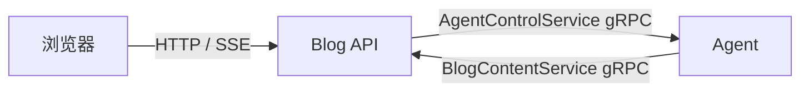

# 项目架构

SCYG.Blog 包含 Vue 浏览器应用、Go Blog API 与 Python Agent。浏览器通过 Blog 使用博客、作者功能与 AI 工作台；访客公共 AI 搜索使用独立匿名身份，作者 AI 沿现有登录会话授权。

## 服务与合同

| 对象 | 职责与权威入口 |
| --- | --- |
| frontend | 公共阅读、真实登录、作者编辑、AI 工作台及匿名搜索；[服务文档](services/frontend/README.md) |
| backend | 用户认证、内容与图片业务、浏览器 HTTP/SSE 边界和内部 BlogContent gRPC；REST 以 [OpenAPI](../backend/api/openapi.yaml)为准；[现行架构](services/backend/architecture/current-state-architecture.zh-CN.md) |
| agent | 内部 gRPC 控制面、health HTTP、Worker、Recipe 执行与恢复；[服务架构](services/agent/architecture.md) |
| contracts | [protobuf/gRPC 源合同](../contracts/proto/)；合同存在不代表调用端已实现 |

Blog 是浏览器 AI 业务的唯一入口；Agent HTTP 只提供健康检查。两个内部 gRPC 服务分别负责 Run 控制和 Blog 业务调用，不供浏览器直接访问。Agent 独立连接自己的 PostgreSQL、Redis 和模型 Provider。

完整业务说明从[模块总览](modules/README.md)进入：登录与会话、文章、分类标签、正文图片、AI 任务和公共搜索。下列数据及身份说明只界定服务归属，不替代各模块规则。

## 数据与身份归属

Blog 拥有用户、文章、分类、标签、图片元数据及文件生命周期。Agent 不读取 Blog 数据库，不持有 Blog DSN；跨服务调用经过合同边界。

Agent PostgreSQL 保存 Run、状态、lease、持久事件、交互和最终结果；LangGraph checkpoint 保存执行恢复状态，二者使用同一应用数据库、账号和 DSN。浏览器 SSE 来自 PostgreSQL 持久事件，Redis 用于 Worker 瞬时流、公共额度和执行名额，不替代业务真相或公开游标。具体边界见 [Agent 架构](services/agent/architecture.md)与[流式合同](services/agent/streaming.md)。

作者使用 Blog 短期 Bearer JWT，公共 AI 搜索使用独立匿名凭证；本地退出和过期清理不代表有服务端 refresh/logout API。Blog 将可信主体及内容范围传入内部 RPC，Agent 逐次校验 Run 所有权和冻结范围；模型参数不能放宽资源权限。

## 实现与验收边界

管理后台只保留不可用路由边界；前端支持桌面 Microsoft Edge，布局下限 1024px。Recipe AgentRunner 是 Agent 唯一生产执行路径；写作交互、结果及文章副作用的完整约定见 [AI 任务模块](modules/ai-assistance.md)，不在项目架构页重述。

运行与检查见[开发指南](development.md)。本文描述当前源码、合同与配置对应的结构，不代表任意目标环境已经部署或验收。真实业务回执按版本与验证范围保存在任务材料中；正式需求和设计须区分目标状态与实现状态。
