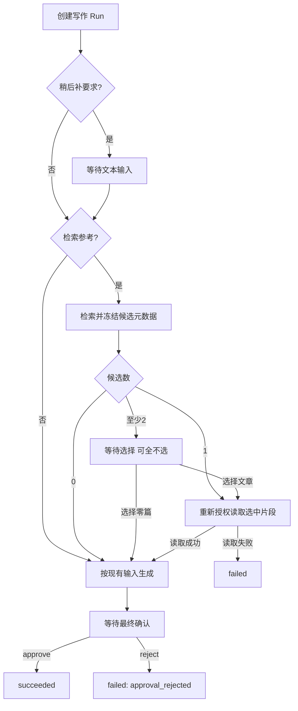

# AI 辅助与 Run 生命周期

作者通过 AI 工作台完成站内检索、草稿生成、原文润色或独立问答，并在任务页查看进度、回应人工交互和取得结果。一次提交对应一个 Run；Run 是可查询、可恢复的服务端任务，不是文章，也不是浏览器连接。

本页维护作者辅助业务和作者、公共搜索共用的 Run 规则。匿名身份、公开内容范围、公共接纳、额度与执行限制统一见 [公共 AI 搜索](public-ai-search.md)；作者登录与会话见 [身份认证](authentication.md)。接口字段与错误合同以 [OpenAPI](../../backend/api/openapi.yaml)、[AgentControlService Proto](../../contracts/proto/scyg/agent/v1/agent_control_service.proto) 和 [共用 Run Proto](../../contracts/proto/scyg/agent/v1/common.proto) 为准，四能力的业务输入、结果和交互以 [Agent contracts.py](../../agent/src/scyg_agent/agents/contracts.py) 为准。

## 从工作台到结果

1. 作者登录后进入 `/author/ai`，选择能力并填写输入。页面先做必要的非空、长度和数量检查；最终是否合法由服务端合同判断。
2. 点击“开始运行”创建任务，成功后进入 `/author/ai/runs/:runId`。创建成功只表示任务已被接纳，不代表模型已经执行或业务成功。可保存任务地址，也可在当前 tab 的工作台使用“打开当前任务”。
3. 任务页先查询最新 Run 快照，再为非终态任务订阅活动通知。写作可能暂停，必须回应当前交互才会继续；其他能力正常情况下直接执行到终态。
4. 从快照读取状态、结果、失败及当前交互。存在结果时按对应能力展示；存在失败时同时展示失败，不因已有内容而隐藏错误。
5. 需要使用生成内容时，由作者预览、复制，再自行进入文章编辑流程。生成、确认和复制均不新建、保存、覆盖或发布文章，当前也不回填编辑器。文章的保存和状态变更属于 [文章模块](articles.md)。

当前四种能力均没有 Blog 写 Tool。Blog 内部存在文章写入 RPC，并不代表 AI 可以调用；AI 的生产工具目录和 Recipe 只授予相应的读取能力。

## 四种作者能力

| 能力 | 输入、正常结果与实际边界 |
| --- | --- |
| 站内搜索 `search` | 提交问题和期望结果数量，展示 Markdown 结论、返回的文章引用与证据。模型可使用站内文章搜索、文章读取工具；无文章引用本身不是失败。查询基于 Blog 文章数据，不是浏览器联网搜索。 |
| 写作草稿 `write` | 提交主题、写作要求和可选参考设置，生成标题、大纲、Markdown 正文及来源 ID。生成后等待最终确认；可选择先补要求或检索参考，完整流程见下文。正文生成模型没有任意 Blog 工具。 |
| 润色对照 `polish` | 提交原文和润色要求，展示原文、润色正文及变更说明。只处理用户提供的文本，不读取或修改原文章。原文对照依赖当前 tab 保存的输入，Run 快照不返回原始输入；换 tab、清除临时状态或存储不可用后，不能从 Run 快照补回原文。 |
| 独立问答 `chat` | 每次提交一个问题，展示结构化回复及返回的来源入口。不同 Run 不共享聊天上下文，当前不是跨 Run 的多轮会话，也未注册 Blog 读取工具；界面能呈现来源字段，不等于聊天会主动检索文章。 |

作者读取文章沿 Blog 管理投影，可包含未删除的草稿、已发布和已归档文章。这里的“作者范围”不是“仅自己创建的文章”：默认 `ContextAuthorizer` 检查当前请求是否有已认证主体，不按文章创建者过滤；文章管理查询也不附加创建者条件。Agent 经内部 BlogContent 读取时，Blog 重新确认账号仍有效，再执行现有管理授权。Run 自身仍严格按创建主体和冻结内容范围授权，不能凭知道 Run 地址访问他人的任务。

对应实现为 [能力 Recipe](../../agent/src/scyg_agent/agents/recipes.py)、[生产运行器](../../agent/src/scyg_agent/agents/production.py)、[只读 Gateway](../../agent/src/scyg_agent/agents/tool_gateway.py)、[BlogContent 读取](../../backend/internal/transport/grpc/blogcontent/read_service.go)、[活动账号解析](../../backend/internal/transport/grpc/blogcontent/server.go)、[默认 Authorizer](../../backend/internal/platform/authentication/context.go) 和 [管理查询](../../backend/internal/modules/content/article/article_query_repository.go)。

## 写作：同一个 Run 内的准备、生成与确认

### 选择参考方式

工作台的两种参考方式含义不同，不能互换理解：

- **手选参考 ID**：页面查询真实管理文章供勾选，但传给 Agent 写作输入的是 ID。生成器不因此读取参考正文；即使输入或结果带有文章 ID，也不能将其表述为“基于这些全文完成写作”。不需要站内正文时可以不选参考。
- **检索参考**：提交参考搜索词，服务端执行固定准备流程，先冻结候选元数据，再决定应读取哪些正文片段。该方式与非空手选 ID 列表互斥。

“稍后补充写作要求”是独立准备项，只能在初始要求为空时启用；可与检索参考配合，也可不检索参考。未启用任何准备项时，直接生成，然后进入最终确认。

### 准备与确认的顺序

1. **可选补要求**：启用延后补充时，先进入文本输入交互。用户提交的文字经去除首尾空白及长度校验后成为实际生成要求；补充完成前不检索参考或生成正文。
2. **候选检索**：启用检索参考时，按搜索词取得有界候选集合。冻结内容只有文章 ID、标题、摘要和状态，候选的未选正文不进入生成输入。
3. **零、一、多候选分支**：零篇时无参考继续；一篇时自动采用；至少两篇时暂停为多选交互。用户只能选择当前候选中的唯一 ID，可以全不选，明确无参考继续；不能注入候选外 ID、重复 ID 或超出交互给定数量。
4. **读取选中片段**：通过同一 Run 的可信主体和读取范围，重新授权读取选中文章，并提取带文章来源和片段标识的有界正文片段。候选元数据不是对未来读取的永久授权。未选文章不进入该阶段，选中读取失败则本次执行失败，不自动换文章，也不偷偷退回无参考生成。
5. **生成草稿**：将主题、已确定的要求及已读取片段交给生成器。检索参考模式返回的来源 ID 必须属于成功读取的参考集合，不能把未读候选写成来源。
6. **最终确认**：生成草稿先写入执行 checkpoint，再通过确认交互显示标题和大纲。确认 `approve` 使该 Run 继续完成；拒绝 `reject` 最终成为 `failed`，失败代码为 `approval_rejected`，不是 `cancelled`。确认不是新建、保存或发布文章，也不是编辑后重新生成的入口。

这些阶段始终属于原 Run，不通过新建 Run 串接。每个阶段有自己的稳定 interactionId；刷新会取得当前持久交互，不重新生成已到达阶段的决定。三类控件分别映射文本提交、候选选择和最终确认，用户不需要编辑 JSON。

回应必须绑定当前 interactionId。服务端在事务中锁定 Run 和交互，再校验决定和内容；文本或选择的 `400` 不消费待处理交互，修正后可作为新操作提交。旧交互、已消费决定或状态不允许时返回 `409`，页面查询新快照，不覆盖原决定。`payload` 缺失与显式 JSON null 是不同的合同值；null 不会被当成合法的补充文本或空选择。合法的空选择必须明确提交空 ID 列表。

流程权威入口为 [WritingInput 与交互校验](../../agent/src/scyg_agent/agents/contracts.py)、[固定准备图与最终确认](../../agent/src/scyg_agent/agents/production.py)、[交互事务](../../agent/src/scyg_agent/application/control.py) 和 [前端交互控件](../../frontend/src/components/ai/AiInteraction.vue)。输入长度、候选数量与片段上限由对应合同和实现维护，不在本页复制参数表。

## Run 状态与结果判断

浏览器使用的状态为：

- `queued`：已接纳、等待执行，也可能是交互回应后的等待继续。
- `running`：Worker 正在执行。
- `waitingForApproval`：等待用户回应，既包括最终确认，也包括文本输入和参考选择，不能只理解为“批准文章”。
- `succeeded`、`failed`、`cancelled`：三个终态。

创建和交互回应返回的是当时的一致快照，不承诺请求返回时已执行到终态。Resume 不是对任意失败任务的“重新运行”按钮；它只消费当前等待交互。已成功或失败的 Run 不能再取消，终态不会因页面重连而重新执行。

状态、结果和失败是独立事实。`result` 非空不等于 `succeeded`，`result` 与 `failure` 可以同时存在，页面应同时呈现；不能为了展示部分结果把 `failed` 改成成功。不能解析的结果结构只显示不受支持提示，不猜字段、不转换成伪成功。没有返回引用或暂时没有活动，也不足以推断任务失败。

## 刷新、断线和离开页面

**GET Run 是业务状态与结果的读取入口；SSE 是活动和变更通知，不是第二份结果真相。** 任务页收到活动后查询快照，结果不依赖拼接 token 流；刷新或打开任务地址也先 GET，非终态才继续订阅。

- 断网、SSE EOF 或终态通知均应重新查询快照。连接正常关闭不能证明 `succeeded`，通知断开也不能证明服务端已停止。
- `Last-Event-ID` 是绑定 Run 的不透明游标，只能保存后原样回送，不能当时间或数值序号计算。游标冲突时可显式“无游标重新连接”，但活动记录可能不完整；恢复业务结果仍靠快照，不重跑模型来补流。
- 当前页面仅对网络故障和临时 `503` 做有界自动恢复，最多三次，并尊重有效等待秒数；`400`、`401`、`404`、`409`、`429` 不进入自动重连循环。停止恢复后可查询状态或手动重连，而不是自动创建新任务。
- 离开任务页、切换路由和关闭本地订阅只释放浏览器连接，不发送 Cancel。服务端可能继续运行、等待交互或产生成本。

浏览器只连接 Blog；SSE 的传输方式、认证头、游标与 subscription-ready 技术细节见 [Agent 流式合同](../services/agent/streaming.md)，部署连接及超时参数见相应服务运行文档。

## 取消与费用边界

取消必须点击“取消任务”并确认；接口不需要请求体，但仍使用独立操作 key。Agent 在 Run 行锁内持久化 `cancelled`、撤销 Worker 租约并清除当前待处理交互指针，原有交互历史保留。旧 Worker 不能绕过租约、revision 和取消围栏提交后续成功终态。

取消是对业务执行和持久提交的围栏，不是对外部模型调用的撤销保证。已经发出的模型或 Blog RPC 可能已经执行；本地调用取消不能证明远端没有执行，更不能保证立即停费或退费。取消请求超时或响应丢失时也不能在本地直接判为已取消，应重试原操作或查询权威快照。

围栏与提交实现见 [control.py](../../agent/src/scyg_agent/application/control.py)、[执行派发](../../agent/src/scyg_agent/agents/execution.py) 和 [terminal_commit.py](../../agent/src/scyg_agent/adapters/database/terminal_commit.py)。

## 结果不明时的幂等与重试

Create、Resume、Cancel 的每个新逻辑操作各生成一个 UUID v4 `Idempotency-Key`。Agent 按 `(owner, key)` 在三个 RPC 之间共享成功记录，自成功提交起保留 24 小时；有效命中时返回原来绑定 Run 的**当前快照**，不重新执行业务。失败不占成功 key。

服务端不会通过请求摘要或操作种类帮助识别错误复用，因此不能跨能力、RPC、Run 或 interaction 借用旧 key。浏览器必须按以下规则操作：

1. **响应结果未知**：网络错误、超时或服务故障不能证明服务端没有提交。保留原 key、原能力、原输入或原交互回应，使用“重试原创建操作”或“重试原操作”；不能趁结果不明改输入、换决定或另发新 key。页面保留 pending 时也阻止不同操作覆盖它。
2. **输入明确被拒绝**：例如 `400` 后仍保留可编辑草稿；修正输入属于新的逻辑操作，生成新 key。交互 `409` 先读取新快照，不能覆盖已接受的旧决定。
3. **未知操作超过窗口**：浏览器从本地操作建立时间起作保守限制，达到窗口后不再自动重放。对未知 Resume，只有快照已明确终态或当前交互已改变、消失，才能清理旧 pending；同一交互仍在时不猜测原决定是否执行，也不允许直接换决定。
4. **显式开始新创建**：未知创建超窗后，用户可确认“放弃未知操作并开始新操作”。这只解除当前页的 pending 记录，保留原草稿，不取消可能已经执行的远端 Run。再次提交是新 key 的独立操作，旧任务可能已产生成本，新任务也可能重复执行并再次产生费用。计时器、刷新和断线恢复都不会自动放弃。

成功窗口不是端到端“模型永远只调用一次”的承诺，也不是过期后可安全重复创建的证明。任务已失败时需要再次尝试能力，应从工作台明确创建新 Run，而不是靠 SSE 重连或误用 Resume 重启旧任务。

## 会话切换与本地保存

工作台输入、润色原文、交互草稿、当前任务入口、游标和未知操作记录保存在按主体分区的 sessionStorage，服务端 Run 持久化与它独立。当前没有用这些记录构成服务端任务历史列表；已有 Run 地址和有效授权才是查询入口。

作者退出、会话失效或切换账号时，页面立即停止旧订阅、取消本地未完成请求并隐藏旧表单、候选、结果入口，清理作者临时状态；跨 tab 的作者会话变化沿既有登录状态事件同步。新账号不能沿旧页面状态继续提交或显示旧任务。浏览器不解码 JWT 决定资源授权，最终以服务端主体、owner 和冻结范围校验为准。

sessionStorage 被禁用或空间耗尽时，当前页面仍可使用内存状态，但不承诺刷新恢复。原文和未确认操作可能无法找回，不能把内存状态说成已持久保存。匿名身份及其失效后的处理不套用作者登录规则，见 [公共 AI 搜索](public-ai-search.md)。

相关实现为 [ai-session-state.ts](../../frontend/src/services/ai-session-state.ts)、[AiWorkspace.vue](../../frontend/src/components/ai/AiWorkspace.vue)、[AiRunView.vue](../../frontend/src/components/ai/AiRunView.vue) 和 [ai-run.ts](../../frontend/src/services/ai-run.ts)。

## 主要拒绝与失败怎么处理

HTTP 拒绝与 Run 执行失败不是同一件事：前者说明本次请求没有取得预期响应，后者是 GET 快照中的任务事实。不要把一个 HTTP 错误直接写成 Run 的本地终态。

| 现象 | 当前处理语义 |
| --- | --- |
| `400`、`413`、`415` | 分别检查业务输入或结构、请求大小、媒体类型。保留可修改输入；交互内容校验失败不消费决定。完整大小和字段约束查合同。 |
| `401` | 作者认证失效，重新登录并停止旧主体活动；不以新账号接管旧 Run。公共认证规则另见公共页。 |
| `404` | 统一表示任务不存在或不可访问，包含非 owner、范围不允许；集成未启用也可返回此状态，不向用户泄露是哪一种。 |
| `409` | 交互过期、已消费、终态或其他前置条件冲突，先查快照。恢复游标冲突可明确重新订阅，不重新执行任务。 |
| `429` | 保留原操作；有有效 `Retry-After` 时等待并禁用重复发送，到期仅恢复手动操作，不自动创建，也不保证下次成功。公共限制的触发原因由公共页维护。 |
| 网络错误、`503`、其他服务故障 | 操作可能结果未知，保留 key 与原输入；已知 Run 先查状态，不能因故障另建任务。订阅恢复与 mutation 重试分别遵守前述规则。 |
| Run 为 `failed` | 展示快照失败代码及脱敏说明。模型或 Blog 依赖失败、授权拒绝、结构化结果不合法、拒绝草稿等可形成失败；保留已有结果和 Run 标识，不把 Provider 原始错误当公开说明。 |

确认继续不保证最终成功。文章在候选选择后变得不可读、依赖不可用或结果不满足结构和来源约束，仍可终止为失败。失败不会回滚为文章写入，因为这条 AI 辅助流程从未保存文章。

## 服务、数据与事务归属

- **Frontend**：提供四能力表单、三类交互、安全 Markdown 展示、复制和 tab 内恢复；只向 Blog 调用业务 HTTP/SSE，不替 Agent 决定状态，也不把生成结果提交给文章编辑接口。
- **Blog**：验证浏览器作者身份，按入口固定能力及内容范围，转发内部 AgentControl 调用并投影 Run；逐次核对返回范围。Agent 读取文章时，经 BlogContent 使用当前活动账号和现有内容授权查询 Blog 数据。Blog 不实现第二套 Run 状态机。
- **Agent**：创建时冻结 owner、范围、输入、Recipe/version 和模型档位，负责 Run 授权、成功幂等、交互消费、Worker 执行和状态提交。客户端不能选择任意 Recipe、Provider 或放宽读取范围。
- **Agent PostgreSQL**：持久保存 Run、业务输入、结果、事件、交互、审计及成功操作记录。创建和成功幂等记录在同一事务；Resume 的决定、交互消费、Run 推进、事件及成功记录在同一事务；Cancel 的状态、围栏、事件及成功记录在同一事务。Worker 在有效 lease/revision 下，用短事务提交结果、状态、事件和审计，避免旧执行覆盖新事实。
- **LangGraph checkpoint**：保存执行恢复点、准备结果和生成草稿，支持同 Run 继续；使用 Agent 应用数据库，但不代替业务状态快照或 SSE 事件日志。Provider 调用不纳入数据库事务，取消或本地回滚不能撤销已发生的外部成本。
- **Blog 数据库与 Redis**：文章仍由 Blog 持有，Agent 不直连 Blog 数据库。Redis 承担 Worker 瞬时流及公共控制，不保存第二份业务结果真相；公开 SSE 从 Agent PostgreSQL 持久事件读取。公共控制的数据与补偿边界见公共页。

因此没有覆盖“模型生成 + 保存文章”的跨服务事务：AI 成功只提交 Agent 的运行结果，文章变化必须由作者另行执行文章业务。持久化装配和进程生命周期见 [Agent 架构](../services/agent/architecture.md)，运行配置、模型和依赖故障操作见 [Agent 运行手册](../services/agent/operations.md)。

## 源码与验证入口

这些入口用于定位规则和组织验证，不表示某个目标环境已通过验收：

- **页面与展示**：[AiWorkspace.vue](../../frontend/src/components/ai/AiWorkspace.vue)、[AiInteraction.vue](../../frontend/src/components/ai/AiInteraction.vue)、[AiResult.vue](../../frontend/src/components/ai/AiResult.vue)、[ai-run.ts](../../frontend/src/services/ai-run.ts)；API 映射在 [request/api/ai.ts](../../frontend/src/request/api/ai.ts)。
- **业务与合同**：[contracts.py](../../agent/src/scyg_agent/agents/contracts.py)、[production.py](../../agent/src/scyg_agent/agents/production.py)、[control.py](../../agent/src/scyg_agent/application/control.py)、[terminal_commit.py](../../agent/src/scyg_agent/adapters/database/terminal_commit.py)；浏览器边界为 [agent_handler.go](../../backend/internal/transport/rest/agent_handler.go)。
- **作者流程与恢复测试**：[ai-workspace.test.ts](../../frontend/tests/component/ai-workspace.test.ts) 覆盖未知创建、超窗显式新建、切换会话清理；[ai-run.test.ts](../../frontend/tests/unit/ai-run.test.ts) 覆盖先查后订阅、EOF、离页不取消、有限重连、原 key/body 重试及未知决定保留；[ai-business.test.ts](../../frontend/tests/component/ai-business.test.ts) 对应交互与结果展示。
- **写作与事务测试**：[test_writing_preparation.py](../../agent/tests/agents/test_writing_preparation.py) 覆盖零/一/多候选、空选择、只读选中片段、来源约束及读取失败；[test_control_postgresql.py](../../agent/tests/application/test_control_postgresql.py) 覆盖共享成功 key、并发创建、输入不消费决定、一次性回应及取消撤销租约；[Worker 测试](../../agent/tests/worker/) 对应派发、持久化和恢复围栏。
- **执行验证**：命令及前置条件见 [Frontend 开发指南](../services/frontend/development.md) 和 [Agent 开发指南](../services/agent/development.md)。真实跨服务验收需要 Blog、Agent、PostgreSQL、Redis、Provider 与浏览器链路；静态测试或能打开页面不能替代该结论。
