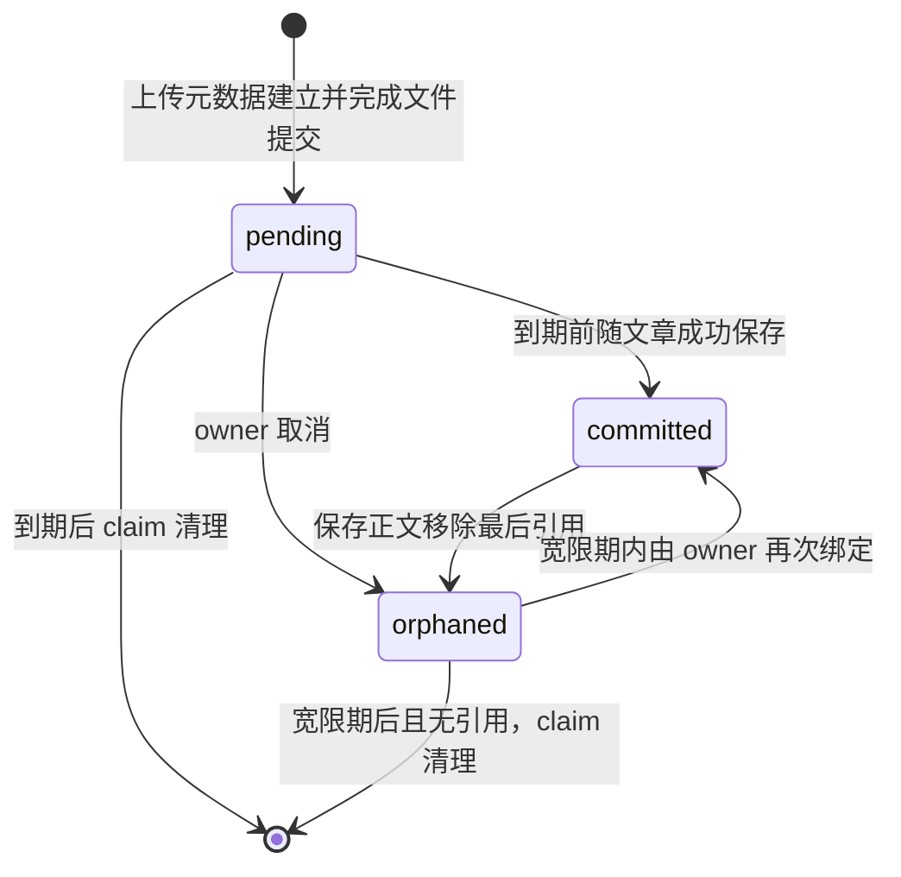

# 正文图片：上传、绑定与回收

正文图片先独立上传，随后由**成功保存的文章正文**绑定。上传返回的 `pending` 图片已经有最终 Blob 文件，但还不是业务上的 `committed` 图片；保存草稿也会提交图片，不必等到文章发布。取消上传和从正文移除图片都不立即删除文件，最终由后台清理处理。

本文供写作台维护者和后端开发者理解一次图片从上传到回收的完整流程。文章状态、版本和保存规则见 [articles.md](articles.md)，登录与会话见 [authentication.md](authentication.md)。分类 `image` 配图是另一种 URL 字段，其规则见 [taxonomy.md](taxonomy.md)；它不通过本页的正文引用表绑定。正文图片也不是文章封面字段，更不是对象存储上传接口：当前 Blob 实现是后端持有的本地文件系统。

## 一次正常写作流程

1. 作者登录，在编辑器选择 JPEG 或 PNG。前端以仅含一个 `file` 的 multipart 请求调用 `POST /api/v1/manage/article-images`，上传和取消都携带作者 Bearer。
2. 后端验证并重新编码图片，暂存 Blob，写入 `pending` 元数据，再提交最终存储文件。成功返回 `201`、规范媒体 URL、图片 ID 和 `expiresAt`。前端保存结构化 ID，取消时不从 URL 反推 ID。
3. 编辑器整批上传成功后才把远程 URL 插入 Markdown。文章请求仍只提交正文等文章字段，不额外提交 `images` 清单；后端从 Markdown 图片节点推导受管引用。
4. 创建文章或保存修订时，后端先在事务外检查正文图片的 Blob 可用性，再在同一数据库事务里保存文章、替换引用、改变图片状态。成功绑定后图片成为 `committed`，前端的 `images.commit()` 只结束本地待取消跟踪，不另发“提交图片”请求。
5. 后续正文不再使用某张图片时，保存成功才移除该文章的引用；只有最后一条引用被移除，图片才进入 `orphaned` 宽限期。其他文章仍引用时保留 `committed`。

**媒体可见性不等于文章可见性。** 当前 `committed` 图片可通过无 Bearer 的媒体 GET 读取，包括由草稿保存提交的图片；媒体读取不查询文章是否发布、归档或软删除。未保存 `pending` 图片的领域读取规则与当前 HTTP 身份链存在差异，见“谁能读取媒体”。

## 上传成功究竟完成了什么

上传有两种临时文件，不能混称为一个“临时图片”：

- **HTTP 请求暂存文件**：REST 把唯一的 `file` part 流式写入系统临时目录，限制文件权限，检查单文件上限、同步、关闭并重新打开供图片服务读取；拒绝缺少、重复或额外 part。处理结束关闭并移除此请求文件。
- **Blob 暂存文件**：验证后的图片写入配置存储根内的 `.article-image-…tmp`。它与最终存储文件同目录，由 Blob 存储层管理，不是浏览器的 `blob:` URL。

图片服务按以下顺序执行：

1. 授权上传，取得当前作者作为不可变的图片 owner。
2. 根据实际内容识别 JPEG/PNG，先检查尺寸，再完整解码并重新编码，拒绝损坏内容和尾随数据；计算的是**重新编码后**字节的大小与 SHA-256。上传文件名和声明的 MIME 不能代替该校验，JPEG 以质量 90 编码，PNG 重新编码，不原样保留输入元数据。
3. 生成随机图片 ID 和受控 storage key，将安全字节写入 Blob 暂存文件并同步。
4. 在一个短数据库事务中插入 `pending` 元数据，`expiresAt = 创建时间 + pending TTL`。
5. 事务提交后，将 Blob 暂存文件提交到最终 storage key。当前实现用 no-replace 硬链接建立最终文件，再清理临时链接；不会覆盖其他目标文件。

因此，**Blob Commit 和图片业务 Commit 是两个动作**：前者发生在上传阶段，只把文件放到最终键；后者发生在文章保存阶段，把 `pending/orphaned` 转成 `committed` 并保存引用。

默认单文件上限为 5 MiB、总像素不超过 25,000,000、任一边不超过 8192；输入和重新编码结果都受字节限制。运行时可注入更严格的图片 Policy。正式 HTTP 上限见 [OpenAPI](../../backend/api/openapi.yaml)，存储、请求体上限和时间配置入口见 [article_images.go](../../backend/internal/platform/config/article_images.go) 及 [config.example.yaml](../../backend/config.example.yaml)，本页不另维护部署配置副本。

### 上传失败与补偿

- Blob 暂存之前失败：不创建图片元数据；REST 尽力清理本次请求暂存文件。
- 元数据插入失败：丢弃 Blob 暂存文件，返回失败。
- 最终文件尚未提交而 Commit 失败：用不继承请求取消的补偿上下文删除仍为 `pending`、未被 cleanup claim 领取的元数据，并丢弃 Blob 暂存文件。补偿失败会返回内部错误，残留元数据留给后续过期清理。
- 最终文件已经建立，但临时链接移除或目录同步失败：存储层以 `Committed()` 标记区分；上传仍返回成功、保留元数据和最终文件，并尽力丢弃残留临时链接，不能把它当作普通失败回删最终文件。
- 图片服务成功后，如果 REST 自身关闭／删除请求暂存文件失败，HTTP 仍会返回错误；这不保证图片元数据和最终文件不存在。客户端未拿到成功 ID 时不能自行定位取消，未绑定图片由 TTL 清理兜底。

数据库与文件系统之间没有分布式事务；文章保存失败也不会撤销此前独立完成的图片上传。

依据：[上传服务](../../backend/internal/modules/content/image/image_upload_service.go)、[内容校验](../../backend/internal/modules/content/image/image_validation.go)、[REST 暂存处理](../../backend/internal/transport/rest/content/article_image_handler.go)、[文件系统提交与幂等删除](../../backend/internal/platform/blobstorage/filesystem.go)。

## 图片状态与时间边界

- `pending`：未被文章保存绑定。默认 TTL 为 24 小时；时间达到 `expiresAt` 时已不能首次提交，即必须严格早于到期时间。时间到达本身不会主动改状态或同步删除文件。
- `committed`：至少经历过一次文章保存确认。已有 `committed` 图片可由其 owner 在多个文章中复用；再次保存不是再次调用领域 `Commit`。它虽然仍保留 `expires_at` 值，清理不会按该字段删除 `committed` 记录。
- `orphaned`：已取消，或已失去最后一条正文引用。默认宽限期为 24 小时，`expiresAt` 从进入该状态的时间重新计算；严格早于到期时间、Blob 仍可用且未被 claim 领取时，同一 owner 仍可通过保存正文重新绑定。
- 对已有 `orphaned` 图片重复取消是幂等成功，不延长宽限期。取消 pending 时实现同时填写 `committed_at` 与 `orphaned_at` 以满足持久化状态约束，不表示它曾绑定文章或公开可读。

`pending TTL`、`orphan grace` 可通过配置调整；取消和正文引用移除使用注入的宽限期。领域时间倒退、已到期图片确认和不允许的状态迁移不会被自动修复为成功。

依据：[生命周期规则](../../backend/internal/modules/content/image/article_image_lifecycle.go)、[Policy 默认值](../../backend/internal/modules/content/image/api.go)、[数据库状态约束](../../backend/migrations/000002_article_images.up.sql)。

## 正文如何成为真实引用

### 识别范围

后端使用 Markdown AST，只从图片节点提取受管图片。例如 ``；HTTP(S) 绝对 URL 只要路径是同一受管前缀，也按该路径提取键，**不校验 URL 的主机是否为 Blog 主机**。键最终必须是 32 位小写十六进制 ID 加 `.jpg` 或 `.png`，重复出现的同一键只形成一条文章—图片关系。

- 普通外站图片不进入本地引用生命周期。
- 纯正文中提到媒体路径不算引用；代码块不是 Markdown 图片节点，也不会绑定图片。
- 受管图片地址中带 query、fragment、空键或嵌套路径会被拒绝，不能借这些写法建立另一种受管引用。
- 将受管地址放在普通 Markdown 链接、原始 HTML（含 ``）或受控路径的反斜杠变体中会被拒绝，不能绕过图片引用流程。

前端可以把相对媒体 URL 规范化为后端绝对地址；后端对相对路径和 HTTP(S) 路径的解析使两者绑定同一个 storage key。解析依据：[Markdown 引用解析](../../backend/internal/modules/content/article/article_image_reference_validation.go)、[存储键校验](../../backend/internal/modules/content/image/article_image_value.go)、[前端图片 API](../../frontend/src/request/api/article-image.ts)。

### 图片 owner 与文章权限是两道检查

`ArticleImages` 对包含受管图片的创建／修订检查文章动作及 `content.article_images.commit` 权限，并取得当前作者。事务内每一张新正文里的受管图片都必须存在、未被 cleanup claim 领取、且 `owner_id` 等于当前作者；不能因为知道另一位作者的公开媒体 URL 就把它绑定到自己的保存操作中。已有正文里保留的图片也会重新检查 owner，不仅检查本次新增键；因此其他作者修订一篇仍含原 owner 图片的文章，即使仅改标题，也可能因图片归属不符被拒绝。

这不意味着文章按创建者隔离。当前运行时 [ContextAuthorizer](../../backend/internal/platform/authentication/context.go) 只要求存在作者 Principal，并不按文章创建者判断资源权限；图片 owner 是上传时记录、在图片工作流中另行强制的归属边界。移除全部受管图片的 Patch 不需要取得新图片 owner，但仍需通过文章修订授权。

### Patch 的顺序与事务归属

1. `PreparePatch` 校验输入、授权修订，加载当前文章并按请求版本生成一次完整修订预览。未传 `content` 时，使用原正文重新解析图片；不是只查看 PATCH 中出现的字段。归档文章不能修订，版本过期会在预览阶段先被拒绝。
2. 在写事务之外，对预览中的所有键调用 Blob Load 做可用性预检。失败返回正文图片校验错误；这里不做媒体 GET 的 owner 读取判断，也不是数据库绑定完成。元数据归属及状态在后续事务中复核。
3. `PatchInTx` 再授权，按预览的旧版本条件保存文章。预检和落库之间若发生其他修订，条件保存失败，不会用过期预览覆盖新版本。
4. 在同一事务中，以文章级事务 advisory lock 串行化引用替换，再按稳定 ID 顺序锁定旧／新图片行；有 cleanup token 的行不参与绑定。校验 owner 和可提交状态，替换引用，持久化新状态，并对移除项重新计数。
5. 任一环节失败，文章更新、引用和图片状态整体回滚。Blob 预检和所有文件 I/O 都在事务外，不持数据库事务等待磁盘。

创建文章使用相同的“预检在外、文章与引用同事务”边界。`ArticleResponses` 在该事务中装配写响应；内部带 `operation_id` 的 `ArticleOperations` 还在同一事务里记录成功账本，成功重放优先于此前的预备错误，不重新提交图片。文章操作幂等的完整规则归 [articles.md](articles.md)。

依据：[ArticleImages](../../backend/internal/modules/content/application/article_images.go)、[文章预览与条件保存](../../backend/internal/modules/content/article/article_service.go)、[引用状态替换](../../backend/internal/modules/content/image/image_reference_service.go)、[引用锁与关联持久化](../../backend/internal/modules/content/image/image_reference_repository.go)、[ArticleOperations](../../backend/internal/modules/content/application/article_operations.go)。

## 谁能读取媒体

`GET /media/article-images/{storageKey}` 是 `security: []` 的公开媒体接口，不是受保护的管理 API，不依赖 Cookie、URL Token 或“当前打开的文章”授权。后端按图片元数据状态决定是否读最终文件：

| 状态／条件 | 图片服务行为 |
| --- | --- |
| `committed` | 不要求 owner、不检查文章状态或引用可见性，任何知道 storage key 的调用者可读取 |
| `pending` | 仅当当前作者上下文存在且匹配图片 owner 时可读；否则统一 404 |
| `orphaned` | 包括 owner 在内一律 404，不因还在宽限期而提供读取 |
| 元数据不存在或 Blob Load 失败 | 404；文件路径存在本身不足以读取 |
| Blob 字节数或 SHA-256 与元数据不一致 | 内部错误，不返回损坏内容 |

**当前正式 HTTP 链的限制：** [认证中间件](../../backend/internal/transport/rest/auth_middleware.go) 对公开路由直接跳过 Bearer 解析，[默认作者提供器](../../backend/internal/platform/authentication/context.go) 又只从 Principal 取作者。因此默认运行时即使给媒体 GET 加上作者 Bearer，也不会建立 pending 所需的 owner 上下文，pending 媒体读取会返回 404。领域服务有“owner 可读取 pending”的能力，不代表普通浏览器在保存前可以实际预览远程 pending 图片。显式开发固定作者或直接注入作者的服务／测试可走通此分支，不能据此推断正式身份链已支持它。

已提交媒体无 Bearer 可读是现有机制：保存草稿、发布、归档不是媒体授权门槛。图片服务也不在 GET 时检查 pending 到期时间；该时间约束用于提交与回收，不能描述为“到点即不可读”。

实际成功读取后才计算条件响应：以 SHA-256 作为带引号的 ETag，匹配 `If-None-Match` 返回无响应体的 `304`；pending 响应为 `private, no-store`，committed 为 `public, max-age=31536000, immutable`，并带 `nosniff` 和 inline 文件名。进入 orphaned 后服务器的新读取为 404，但已有公开缓存不会被主动撤回，取消或移除引用不等于清除所有浏览器缓存。

依据：[媒体服务](../../backend/internal/modules/content/image/image_media_service.go)、[媒体响应处理](../../backend/internal/transport/rest/content/article_image_handler.go)、[OpenAPI](../../backend/api/openapi.yaml)。

## 取消编辑、未保存草稿与最后引用

### 取消上传不是删除已提交媒体

`DELETE /api/v1/article-images/{imageId}` 先授权并取得当前作者，在短事务中锁定未被 claim 领取的图片：不存在或不是本人 owner 返回 `404`；本人 `pending` 转为 `orphaned`；本人已有 `orphaned` 返回成功；`committed` 返回 `409`。成功是 `204`，不立即删除 Blob，不替换正文引用。不能用此接口解除已保存文章的图片关系。

取消不检查 pending 是否已到期；只要元数据仍存在、状态允许且未被清理领取，仍可进入 orphaned 宽限期。与其相反，到期图片不能通过保存正文重新首次确认。

### 前端如何收尾

[image-lifecycle.ts](../../frontend/src/services/image-lifecycle.ts) 跟踪当前编辑会话上传成功的 `{id, url, expiresAt}`，不是服务器状态机副本：

- 本地 `blob:` 预览独立跟踪，上传成功只释放该文件自己的预览；离页时释放剩余本地对象 URL。
- 多文件批次中有任一上传失败，编辑器不插入该批的 URL；已上传成功部分由 `retainForCancel` 保留，之后文章即使保存成功，这些未插入项仍等待取消。
- 文章保存成功后 `commit()` 移除普通待取消项，仅保留上述失败批次成功项。它不会重新解析 Markdown，也不会替服务器把所有上传记录变为 committed；已上传但保存正文实际未引用的图片仍是 pending，最终靠 TTL 回收。
- 保存请求失败或被 mutation guard 拦截时，以及组件卸载时，对仍跟踪的图片 ID 执行取消；使用 `Promise.allSettled`，单项失败不妨碍其余取消。跟踪集合在发起取消时清空，失败项不会在同一实例内无限重试，而是提示“临时图片将由服务端过期清理”。

保存失败会保留文章草稿，但已经成功取消的图片 URL 可能仍在草稿正文中；取消后的 orphaned URL 不能读取，宽限期内仍可能由同 owner 的后续保存重新绑定。这不能当成“草稿保留便保证远程图片一直可预览”。编辑器卸载清理也是尽力执行，浏览器中断、网络失败或未收到上传成功响应时，以服务端 TTL 为最终兜底。

### 最后引用与文章软删除不同

正文 Patch 移除一张图片后，只有 `article_image_references` 中该图片的总引用数归零，才将 committed 置为 orphaned 并开始宽限期。重复 Markdown 图片节点只计一个关系，同 owner 的多篇文章可共享一张图片，移除其中一篇的引用不会误回收其他篇仍使用的文件。

**文章软删除当前不会移除图片引用。** [article.Service.Delete](../../backend/internal/modules/content/article/article_service.go) 只保存文章删除状态，没有调用图片工作流；软删除也不会触发数据库外键的物理 `ON DELETE CASCADE`。残留引用仍参与计数，图片继续 committed，不会因为所属文章软删除自动进入清理候选，媒体仍可公开读取。发布和归档同样不重写图片引用。需要理解的当前边界是“最后一条数据库引用被正文保存移除”，不是“最后一篇公开文章消失”。

前端流程依据：[编辑器批量上传](../../frontend/src/components/editor/RichMarkdownEditor.vue)、[文章保存及卸载处理](../../frontend/src/views/author/ArticleEditorView.vue)。

## 后台如何安全删除文件

后台 worker 按配置间隔串行执行单轮清理，同一实例不重入；失败记录后续轮次继续处理，不承诺在 `expiresAt` 那一刻已经删除。

1. **短事务领取候选**：分别按 pending、orphaned 查询 `expires_at <= 本轮时间` 的记录；每种最多 100 条，按到期时间和 ID 排序，用 `FOR UPDATE SKIP LOCKED` 跳过其他实例持锁行。仅领取没有 token 或租约已过期的记录；orphaned 还必须确认引用数为零。写入随机 claim token 和一小时租约，随即提交事务。
2. **短事务复核**：用图片 ID 与精确 token 锁定候选，再核对状态和到期条件，orphaned 再查无引用；不再合格则释放该 token，不删除 Blob。被领取记录不能同时被取消或重新绑定，因为这些写操作只接受 token 为空的图片。
3. **事务外删除最终 Blob**：幂等删除最终 storage key，文件已经不存在也视为成功。失败时按自己的 ID/token 释放 claim；如果释放失败或进程崩溃，租约到期后可被其他轮次重新领取。
4. **短事务完成**：重新按 ID/token 锁定并核对预期状态，随后按 ID、状态、精确 token 删除元数据。旧 worker 的 token 若已被其他领取替换，不能完成或释放新领取；Blob 已删但数据库完成失败时，可由后续轮次以幂等删除恢复。
5. **独立清理 Blob 临时文件**：枚举 Blob 存储根内本实现拥有、修改时间早于 `本轮时间 - pending TTL` 的临时文件，每轮最多 100 个并幂等删除。它们不走图片元数据 claim；此扫描也不负责系统临时目录中的 HTTP 请求暂存文件。

claim 的一小时是**重新领取门槛**：完成／释放依赖 token 仍匹配，并没有另一个“当前时刻必须早于租约截止”的条件。不能把它描述为旧 worker 一旦过了墙钟时间就必然无法完成；只有 token 被替换后才失去该记录的完成权。

清理不扫描所有最终文件来推断引用，也不把 committed 转为 orphaned。进入待回收状态由图片业务负责；元数据与最终文件的最终删除由清理流程负责。

依据：[清理用例](../../backend/internal/modules/content/image/image_cleanup.go)、[claim Repository](../../backend/internal/modules/content/image/image_cleanup_repository.go)、[worker 生命周期](../../backend/internal/bootstrap/article_image_cleanup_worker.go)、[claim 迁移](../../backend/migrations/000003_article_image_cleanup_claims.up.sql)。

## 失败语义与数据归属

| 场景 | 当前结果与调用方含义 |
| --- | --- |
| 上传／取消缺少或无效作者 Bearer | HTTP `401`；作者身份有效但动作被拒绝为 `403` |
| multipart 不唯一、缺文件、超文件限制、格式／尺寸／完整性不合法 | `400 validation`，不能依赖上传文件名或 MIME 绕过 |
| 正文受管 URL 不合法、Blob 预检失败、图片 owner 不符、确认时已过期或图片被 claim 排除 | 文章保存 `400 validation`；同一事务的文章／引用／状态不部分落库 |
| Patch 的文章版本已变化 | `412 stale_version`；不是图片上传撤销信号，上传资源独立存在 |
| 取消他人／不存在／被 claim 领取的图片 | `404 not_found`，不向调用方区分这些情况 |
| 取消 committed 图片 | `409 conflict`，应通过文章保存修改正文引用 |
| 媒体不存在、orphaned、pending 无 owner 上下文或文件不能加载 | `404 not_found`；给公共媒体 GET 加 Bearer 不解决当前 pending 上下文缺失 |
| 媒体内容与元数据不一致、数据库／存储内部故障 | `500 internal`，不把内部原因或原始异常当作对外业务承诺 |

稳定分类来自 [image/errors.go](../../backend/internal/modules/content/image/errors.go) 和 [REST 错误映射](../../backend/internal/transport/rest/content/problem.go)。取消 committed 的冲突与“保存正文时确认过期图片”的校验失败不同，不能统一写成图片状态错误都返回 409。

- `content/article` 拥有文章数据、版本和软删除；不直接操作图片 Repository。
- `content/image` 拥有 `article_images` 元数据、`article_image_references`、图片状态、owner、Blob 协议和 cleanup claim；这些表使用自身生命周期字段，不套文章审计软删除模型。图片回收删除的是元数据记录和 Blob，不是给图片写 soft-delete 标记。
- `content/application.ArticleImages` 拥有文章写入与图片引用替换的跨 feature 原子边界；通过 feature 的 `InTx` 协作，不直接写 SQL 或在事务中读写文件。
- REST 拥有 multipart、请求暂存、HTTP 状态／headers；前端只拥有编辑会话本地跟踪，不能代替服务端 owner 或引用判定。
- Blob 文件和 PostgreSQL 各自持久化，没有跨资源原子提交；数据库外键只能保证引用指向存在记录，不代表已完成 Blob 文件提交或媒体可见性授权。

## 源码与验证入口

以下是维护当前行为的检查入口，不表示本次文档整理运行过测试：

| 要核对的行为 | 入口 |
| --- | --- |
| HTTP 操作、单 `file` 契约、文章 DTO 无额外图片清单 | [OpenAPI](../../backend/api/openapi.yaml)、[article_image_test.go](../../backend/internal/contracttest/article_image_test.go) |
| 内容重编码、尾随数据、键与到期边界 | [image_test.go](../../backend/internal/modules/content/image/image_test.go) |
| Markdown 节点提取、相对／绝对路径去重、非法受管引用 | [article_image_reference_validation_test.go](../../backend/internal/modules/content/article/article_image_reference_validation_test.go) |
| owner 不符时文章回滚、多文章引用、最后引用 orphan | [article_images_integration_test.go](../../backend/internal/modules/content/application/article_images_integration_test.go) |
| 预备后其他修订的版本栅栏、成功操作重放优先 | [operation_preparation_integration_test.go](../../backend/internal/modules/content/application/operation_preparation_integration_test.go) |
| HTTP 暂存与 configured limit、ETag、失败暂存清理 | [article_image_spool_test.go](../../backend/internal/transport/rest/content/article_image_spool_test.go)、[article_image_configured_limit_test.go](../../backend/internal/transport/rest/content/article_image_configured_limit_test.go)、[article_image_http_test.go](../../backend/internal/transport/rest/content/article_image_http_test.go)、[article_image_cleanup_test.go](../../backend/internal/transport/rest/content/article_image_cleanup_test.go) |
| 同字节大小但不同摘要的 Blob 被拒绝 | [image_media_service_test.go](../../backend/internal/modules/content/image/image_media_service_test.go) |
| claim 在外部删除前存在、删除失败释放并可重试 | [image_cleanup_integration_test.go](../../backend/internal/modules/content/image/image_cleanup_integration_test.go) |
| 最终文件提交后的临时清理故障、幂等与路径安全 | [filesystem_fault_test.go](../../backend/internal/platform/blobstorage/filesystem_fault_test.go)、[filesystem_security_test.go](../../backend/internal/platform/blobstorage/filesystem_security_test.go) |
| 前端只取消未提交 ID、失败批次保留、本地预览释放、逐项失败隔离 | [image-lifecycle.test.ts](../../frontend/tests/unit/image-lifecycle.test.ts)、[task-9-article-image.spec.ts](../../frontend/tests/e2e/task-9-article-image.spec.ts) |

[HTTP／PostgreSQL／文件系统生命周期测试](../../backend/internal/transport/rest/content/article_image_lifecycle_integration_test.go) 使用固定作者提供器，因此其中 pending 读取成功只证明注入 owner 上下文后的分支；[前端 Edge 图片场景](../../frontend/tests/e2e/task-9-article-image.spec.ts) 使用受控 API／媒体响应，也不能证明正式 Bearer 中间件支持 pending 预览。正式身份链须结合上述认证源码判断，不能用这两类 fixture 覆盖结论替代真实运行验证。
