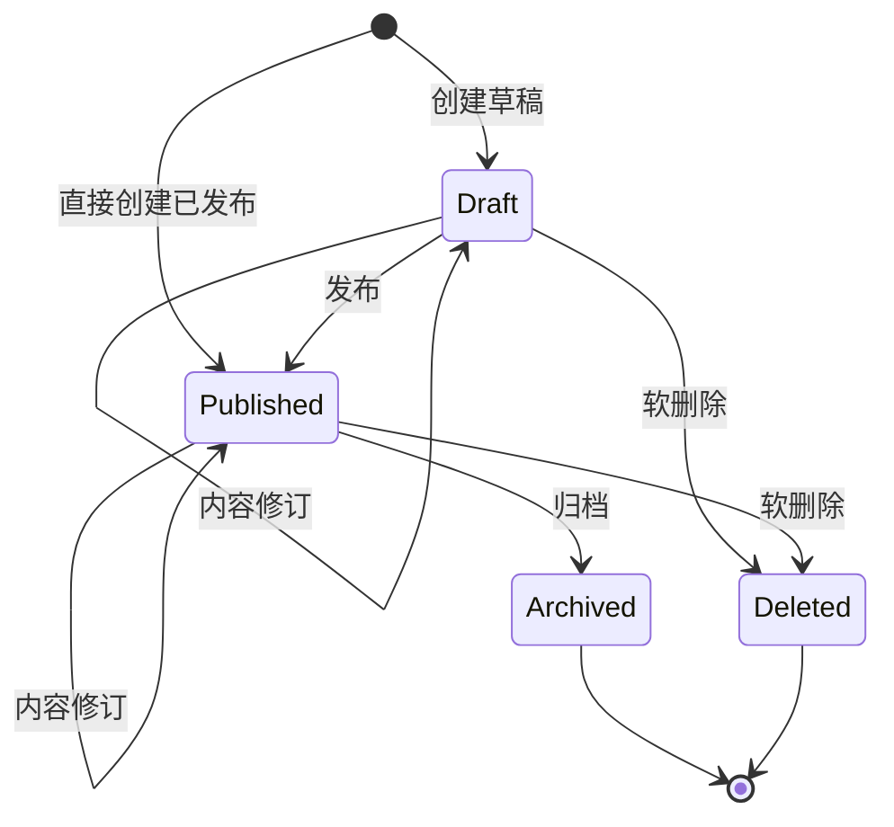

# 文章：从草稿到公开、归档与删除

本文面向作者界面、HTTP／内部 RPC 调用方及内容模块维护者，说明如何保存一篇文章、控制公开范围，并在并发修改或结果不明时正确处理。接口字段与状态码全集以 [OpenAPI](../../backend/api/openapi.yaml) 和 [BlogContent Proto](../../contracts/proto/scyg/blog/v1/blog_content_service.proto) 为准。

## 完成一次文章保存

1. [登录作者会话](authentication.md)，进入 `/author/articles/new`；编辑已有文章使用 `/author/articles/:id/edit`，从管理详情读取文章及当前版本。
2. 填写标题、链接名、正文，选择一个存在且未删除的分类，可选多个标签。分类和标签的维护见[分类与标签](taxonomy.md)。新建页面会根据标题生成可手改的链接名，根据 Markdown 生成摘要。
3. 点击“保存文章”。当前作者编辑器新建时固定保存为草稿；编辑时 PATCH 内容，不改变发布状态。保存成功后用服务端资源和版本更新本地快照，新建成功会进入该文章的编辑地址。它不是自动保存，也没有在此页面提供发布／归档动作按钮。
4. 需要公开时，调用独立发布动作；也可以在管理创建 API 中明确选择直接创建为已发布。发布后的内容修订立即修改同一篇公开文章，不生成一份独立的待发布草稿。
5. 发生版本冲突时，先保留本地草稿，再重新读取并处理差异，不能用旧版本反复覆盖。编辑器保存失败会保留草稿并给出反馈；临时图片的处理遵循[正文图片](article-images.md)。

作者路径与保存逻辑见 [ArticleEditorView.vue](../../frontend/src/views/author/ArticleEditorView.vue) 的 `initialize`、`save`，草稿转换见 [editor-draft.ts](../../frontend/src/stores/editor-draft.ts) 的 `toCreate`、`toPatch`。前端摘要生成、链接名生成及保存前移除 Markdown data URL 图片是客户端行为，不等于服务端重写正文。

## 文章是什么，谁能读写

一篇文章有一个必选分类、若干标签、一份当前内容、生命周期状态和正整数版本。版本用于乐观并发控制，不是可恢复的历史修订列表；当前业务没有文章历史版本回滚、归档恢复或删除恢复入口。

| 读取入口 | 可见文章 | 用途 |
| --- | --- | --- |
| `GET /api/v1/articles`、`/articles/{articleId}` | 仅 `published` 且未软删除 | 匿名文章列表和详情；登录也不扩大此入口的可见范围 |
| `GET /api/v1/manage/articles`、`/manage/articles/{articleId}` | 所有未软删除文章，包括草稿、已发布、已归档 | 受保护的编辑和管理读取 |
| BlogContent `SearchArticles`／`GetArticle` | `public` 范围复用公开查询，`author` 范围复用管理查询 | 可信内部调用；范围由服务端决定，不由模型自行选择 |

公开与管理列表均支持分类、标签和关键词筛选；关键词实际匹配标题或摘要，不是正文全文搜索。HTTP 列表默认每页 20 条、最多 100 条，默认按创建时间降序，另有契约列明的时间／标题排序。HTTP 管理列表不提供状态筛选参数；内部 BlogContent author 搜索另支持状态筛选。公开详情不可见时返回 `404`，而不是返回草稿或归档内容。

默认运行装配使用 `ContextAuthorizer`：只检查请求上下文是否有认证 Principal，不按 action、resource 或文章创建者过滤。文章表也没有文章 owner 字段。因此“作者管理”不是“只能管理自己创建的文章”，当前没有文章 owner 隔离或角色权限矩阵。显式开发身份会由组合根改用开发 Authorizer，不能当作生产身份规则。HTTP 登录与内部 RPC 活动账号校验的差异集中见[作者登录与会话](authentication.md)。

读取条件见 [article_query_repository.go](../../backend/internal/modules/content/article/article_query_repository.go) 的 `get`、`List`、`ListManage`；实际授权见 [context.go](../../backend/internal/platform/authentication/context.go) 的 `ContextAuthorizer.Authorize` 和 [construct.go](../../backend/internal/bootstrap/construct.go)；内部范围分流见 [read_service.go](../../backend/internal/transport/grpc/blogcontent/read_service.go)。

## 内容、状态和版本

### 内容保存的真实约束

创建必须明确选择 `draft`（HTTP 状态值 `1`）或 `published`（`2`），不能直接创建 `archived`（`3`）。两种合法创建状态使用相同的内容校验：草稿也需要完整的标题、链接名、摘要、正文与分类，不支持空正文草稿。

- 标题和摘要去首尾空白，分别最多 120、500 个 Unicode 字符，必须非空且不含控制字符。
- 链接名按领域规则去首尾空白并转小写，限定为小写字母／数字及分隔连字符，最多 160 个字符。HTTP 请求还必须先满足 OpenAPI 的规范小写模式，不能依赖领域层替请求修正大小写。
- 正文必须是合法 UTF-8 且不全为空白；允许 LF、CR、TAB，拒绝其他控制字符。通过校验后保存原字符串，包括首行缩进、首尾空格和换行，不做 Markdown 重排、裁剪、HTML 清理或服务端摘要生成。当前没有额外的正文长度上限、最低段落数或发布质量校验规则。
- 分类、标签 ID 必须有效且引用未删除资源；标签可为空，但不能重复。未删除文章的标题与链接名各有唯一约束，归档文章也继续占用这些唯一值。软删除后相应唯一值可供新文章使用，不代表恢复原文章。
- PATCH 至少提供一个可编辑字段；未提供的字段保持原值，`tagIds: []` 明确清空标签，省略 `tagIds` 则保留。状态不属于 PATCH 字段。有效版本下所有内容都未变化时返回业务冲突，不额外增加版本。

规则由 [text_value.go](../../backend/internal/modules/content/article/text_value.go)、[article_service.go](../../backend/internal/modules/content/article/article_service.go) 的 `ValidatePatch`／`applyPatch`、[article.go](../../backend/internal/modules/content/article/article.go) 的 `Revise` 维护；数据库唯一约束见 [000001_initial.up.sql](../../backend/migrations/000001_initial.up.sql)。受管正文图片引用还需完成图片校验和绑定，详见[正文图片](article-images.md)，不能把“URL 已写进正文”当成绑定成功。

### 生命周期与可重入结果

创建版本为 `1`。有实际内容变化的修订、发布、归档和软删除都会增加一次版本并更新时间；失败不提交这些修改。发布只接受草稿，归档只接受已发布；草稿和已发布可修订、可软删除，归档不可修订、不可删除、不可再次发布。

`Deleted` 表示软删除标记及删除时间，不是第四种 `status`；记录仍在数据库，但公开和管理正常读取均不返回。归档是当前业务的终止状态，图中的结束不代表物理删除。

普通 HTTP 生命周期操作不提供成功重放账本：

- 已发布文章再发布，或已归档文章再归档，如果提交的是当前版本，返回 `409` 状态冲突；重复提交原成功请求的旧版本通常先得到 `412`。
- 归档文章以当前版本 PATCH／DELETE 返回 `409`；不能通过删除归档来绕开终止状态。
- 正常串行地重复删除已删除文章，后一次查不到未删除记录，返回 `404`，不是再次 `204`。并发请求若先读到旧记录再争用条件写入，也可能返回版本过期。
- 重复内容 PATCH 在版本正确但没有变化时是 `409`，不是幂等成功；创建重试也没有 HTTP `operation_id`，重复请求可能遇到标题／链接名冲突。

状态判断与版本检查顺序见 [article.go](../../backend/internal/modules/content/article/article.go) 的 `current`、`changeable`、`Publish`、`Archive`、`Delete`，软删除查询见 [article_repository.go](../../backend/internal/modules/content/article/article_repository.go) 的 `Find`。

### expected version 与 HTTP ETag

详情、创建及成功修订／状态动作返回强 ETag，例如 `ETag: "3"`。HTTP PATCH、DELETE、发布和归档均须在 `If-Match` 中提交当前强 ETag。缺失返回 `428`，弱标签、通配符或非法格式不能作为版本提交；旧版本返回 `412`。调用方应使用返回资源的新版本继续操作。

内部 BlogContent 的更新、发布、归档以 `expected_version` 表达同一并发要求；不通过 HTTP ETag。最终持久化使用文章 ID、旧版本和未删除条件进行更新，因此图片预检查之后出现的并发修改也不能被预先准备的 PATCH 覆盖。版本规则见 [etag.go](../../backend/internal/transport/rest/content/etag.go)、[article_repository.go](../../backend/internal/modules/content/article/article_repository.go) 的 `update` 和 [article_transaction.go](../../backend/internal/modules/content/article/article_transaction.go)。

## 保存为什么是一个业务事务

Blog 后端拥有文章、文章标签关联、分类标签、图片元数据及引用等内容数据。前端只持有草稿和服务端快照；Agent 不直接写这些表。

HTTP 文章读写由应用层协调，而不是由 handler 分别保存后再拼接：

- 公开／管理文章与其分类摘要在同一个只读、可重复读快照中装配，避免同一响应内的文章和分类来自不同时点。
- REST 创建、PATCH、发布、归档通过 `ArticleResponses` 开启写事务，调用文章／图片工作流，再在提交前取得必需的分类摘要。找不到有效分类或分类摘要装配失败，会连同文章和本次图片引用变化回滚；不能出现“接口报失败但这次内容已保存”的这一类半成功。
- `ArticleImages` 将正文中受管图片的准备检查放在写事务外，将文章和引用替换放在同一数据库事务中；Blob 文件不是数据库事务的一部分。保存失败不会提交本次绑定。图片上传、取消和清理是独立生命周期，见[正文图片](article-images.md)。
- 软删除走文章自身事务，只标记文章删除，不解除 `article_image_references`，也不会自动把图片变为孤儿。已提交媒体的公开读取不按引用文章是否公开／删除来过滤；文章不再可见不代表图片 URL 失效。本文不把软删除承诺成图片撤回或物理擦除。

事务入口见 [article_responses.go](../../backend/internal/modules/content/application/article_responses.go) 的 `get`、`list`、`write`，绑定入口见 [article_images.go](../../backend/internal/modules/content/application/article_images.go)，删除入口见 [article_service.go](../../backend/internal/modules/content/article/article_service.go) 的 `Delete`。

## BlogContent 写入的 operation_id 幂等

内部 BlogContent 提供 Create、Update、Publish、Archive 四个写 RPC，没有删除 RPC。它们使用 `ArticleOperations` 的成功账本；这与浏览器文章保存、Agent Run 的幂等不是同一机制。当前 AI 四能力没有 Blog 写 Tool，拥有这些内部 RPC 不等于生成内容会自动保存或发布，见 [AI 辅助](ai-assistance.md)。

调用方为每个新逻辑写入生成 UUID v4 `operation_id`，只有重试同一逻辑写入时沿用原 key：

1. key 的作用域是全局的，不按用户、文章或 RPC 分区；大小写 UUID 被规范化。不能跨用户、跨文章或跨动作复用。
2. 同一 key 的请求串行仲裁。新写入把文章、标签／图片引用变化和成功账本放在同一 PostgreSQL 事务内；失败回滚，不占成功 key。Create／Update 的图片预备读取不在该事务内。
3. 成功记录自提交成功时起有效 24 小时。有效 key 重放不再执行请求动作，也不比较新请求内容或动作类型，而是返回原 key 绑定文章的**当前管理投影**，不是当年成功响应的冻结副本；因此重放可能看到更高版本和后续归档状态。
4. 重放仍须通过当前调用身份和管理读取授权。文章已软删除时无法借 key 恢复，也不能取得已删除文章。Create／Update 的预备错误会延后到排除成功重放之后才影响新写入，旧请求字段失效不应导致一次已经成功的动作重做。
5. key 到期后可能按新操作处理；不能无限期依赖它去重。重复创建可能成为新的创建尝试，重复状态动作仍受当前状态和版本约束。

这条路径使用自己的 `ArticleOperations` 事务，不经过 REST 的分类摘要响应装配。RPC 最后还会查询标签名称并映射响应；响应映射在写事务之后，若此时失败，不能据此判断业务写入未发生，应沿用原 key 重试，而不是换 key 再写。

仲裁和返回行为见 [article_operations.go](../../backend/internal/modules/content/application/article_operations.go) 的 `execute`，保留窗口见 [operation_repository.go](../../backend/internal/modules/content/operation/operation_repository.go) 的 `reserve`、`complete`；RPC 身份、key 校验和响应映射见 [server.go](../../backend/internal/transport/grpc/blogcontent/server.go)、[write_service.go](../../backend/internal/transport/grpc/blogcontent/write_service.go)、[article_mapper.go](../../backend/internal/transport/grpc/blogcontent/article_mapper.go)。

## 失败后如何继续

HTTP 内容错误统一使用 RFC 9457 Problem；页面不应从数据库原始错误推断业务结果。

| 结果 | 业务含义与后续动作 |
| --- | --- |
| `400` | 请求结构、内容、ID、重复标签或 ETag 格式不合法；修正输入，不新增正文规则来掩盖问题 |
| `401`／`403` | 会话不可用或授权拒绝；先恢复合法身份，不把前端写入守卫当成授权证据 |
| `404` | 文章不存在、已删除，或在公开入口不可见；不要自动创建一篇替代文章 |
| `409` | 标题／链接名重复、无内容变化、状态迁移不允许，或分类／标签／图片等业务前置条件不满足；检查当前资源和请求，不做盲目重试 |
| `412`／`428` | 版本过期／缺失；重新读取并协调本地修改后再提交 |
| `500` 或网络结果不明 | 不能只凭客户端失败判断服务端未执行；HTTP 保存先读回确认，BlogContent 同一操作沿用原 key |

内部 RPC 的非法输入对应 `INVALID_ARGUMENT`，旧版本对应 `ABORTED`，状态／前置条件冲突对应 `FAILED_PRECONDITION`，唯一性冲突对应 `ALREADY_EXISTS`。具体映射维护在 [problem.go](../../backend/internal/transport/rest/content/problem.go) 与 [server.go](../../backend/internal/transport/grpc/blogcontent/server.go)，不是另一套业务规则。

## 源码与验证入口

以下是现有验证入口，不代表文档维护时已经执行：

- [article_integration_test.go](../../backend/internal/modules/content/article/article_integration_test.go)：`TestServicePostgresPreservesLifecycleQueriesAndStaleVersion` 覆盖草稿不可公开、发布、修订、旧版本和软删除。
- [text_value_test.go](../../backend/internal/modules/content/article/text_value_test.go)：`TestArticleMarkdownWhitespaceSurvivesCreationAndRevision`、`TestContentRejectsWhitespaceInvalidUTF8AndOtherControls` 固定正文原样保存与控制字符边界。
- [article_creation_handler_test.go](../../backend/internal/transport/rest/content/article_creation_handler_test.go)：合法创建状态、创建响应元数据与伪造归档状态拒绝。
- [article_responses_integration_test.go](../../backend/internal/modules/content/application/article_responses_integration_test.go)：`TestArticleResponsesPostgresPreservesWriteVersionAndCategory`、`TestArticleResponsesPostgresRollsBackWritesWithoutLiveCategory` 覆盖分类响应与四类写入回滚。
- [article_images_integration_test.go](../../backend/internal/modules/content/application/article_images_integration_test.go)、[operation_preparation_integration_test.go](../../backend/internal/modules/content/application/operation_preparation_integration_test.go)：绑定事务及预备 PATCH 的并发版本栅栏。
- [article_operations_integration_test.go](../../backend/internal/modules/content/application/article_operations_integration_test.go)：并发同 key、当前投影重放、失败重试、到期和当前访问权限。
- [t9-article-list.test.ts](../../frontend/tests/component/t9-article-list.test.ts)、[task-9-article-image.spec.ts](../../frontend/tests/e2e/task-9-article-image.spec.ts)：列表筛选／续页及受控浏览器保存图片交互；受控 API 不替代真实后端事务验收。测试命令与环境见[后端开发指南](../services/backend/guides/backend-development.md)和[前端开发指南](../services/frontend/development.md)。
